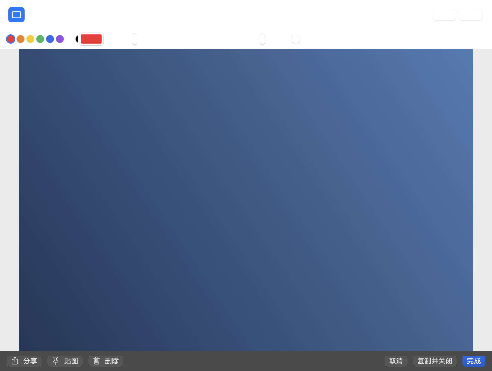
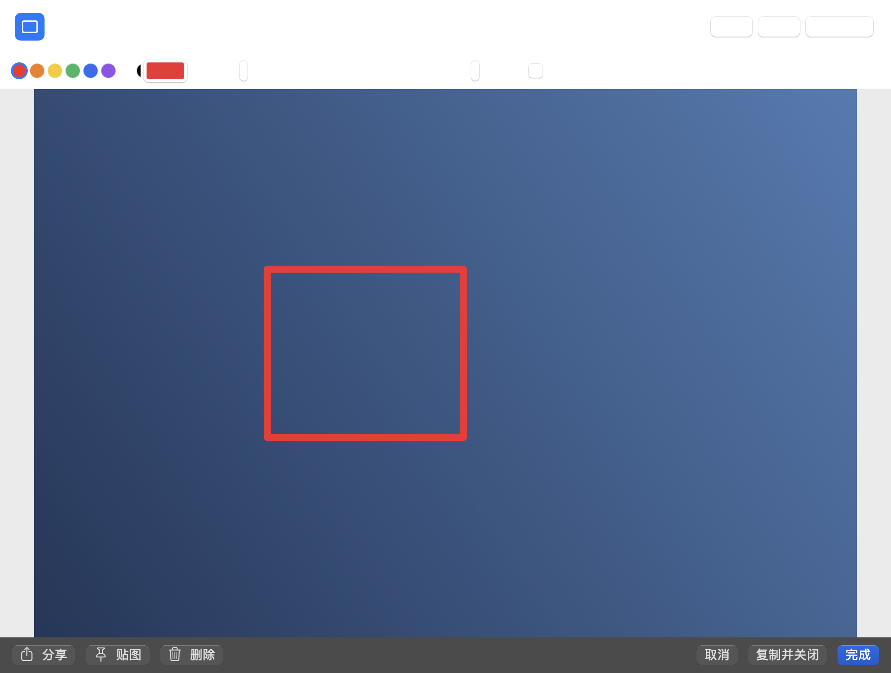
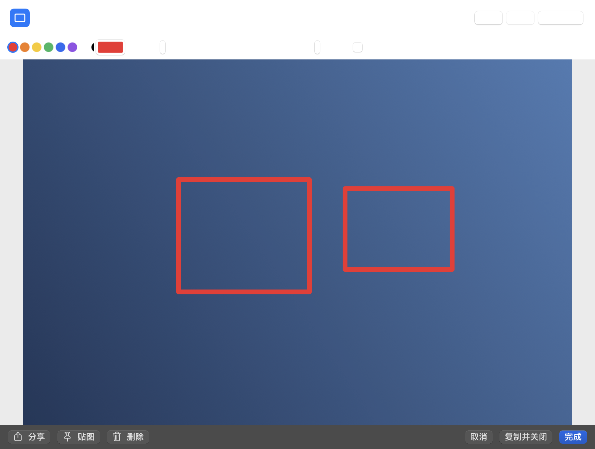
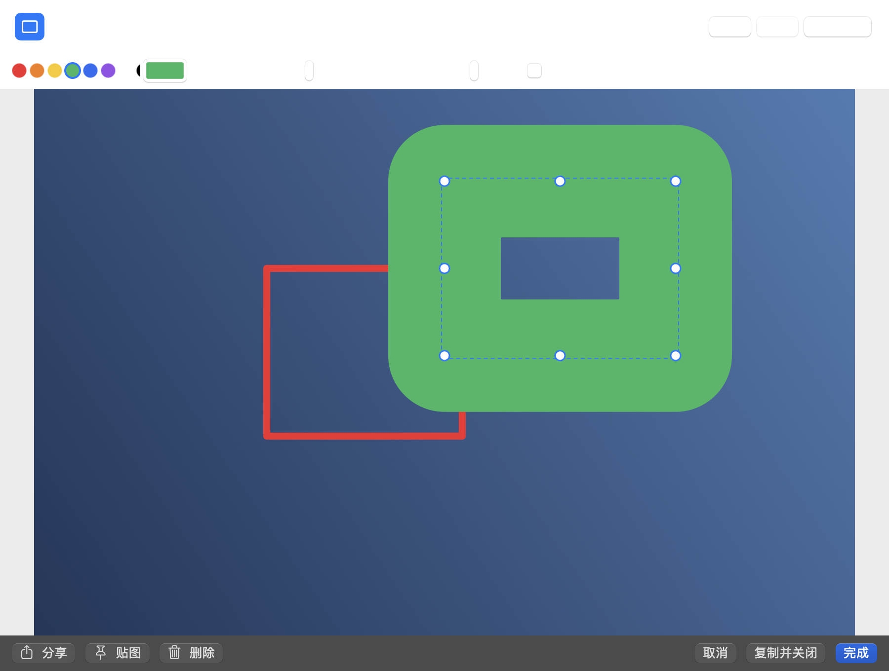
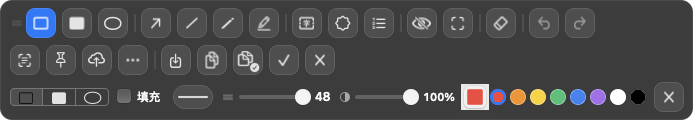

# 截图标注实机验收记录（2026-11-16）

关联任务书：`SCREENSHOT_ANNOTATION_PARITY_TASK.md` §6.5
关联不变量：`docs/engineering/regressions/screenshot-reliability.md` —「标注工具栏与编辑历史」

## 方式与范围

本次不是模拟器或纯模型测试，而是启动一个真实的 macOS `.app` 进程（debug 构建，bundle id `com.misswell.macpilot.acceptance`），以 `--acceptance-annotation` 进入验收模式：

- 跳过 `MacPilotAppServices`，不注册全局快捷键、不读写用户 `config.json`、不采集屏幕、不请求 TCC 授权。
- 打开真实的 `SmartAnnotationWindowController` 全编辑器与真实的 `AreaSelectionActionBar`。
- 用真实 `NSEvent` 驱动窗口按键与鼠标；用真实 `NSPasteboard` 复制；用 `NSView.cacheDisplay` 保存窗口画面。
- 区域截图裁剪本身由固定测试图像代替；本记录验证的是标注交互层，不是 ScreenCaptureKit 采集链路。

原始记录与完整截图在 `docs/engineering/acceptance/assets/screenshot-annotation-parity/`。

## 环境

- macOS：版本 27.2.1（版号 26B131）
- 构建：`b33f610`
- 会话状态：**已解锁**（`IOConsoleLocked = No`）

## 结果

| 验收项 | 结果 | 证据 |
|---|---|---|
| 完整编辑器窗口激活 | 通过 | `isKeyWindow=true` |
| 鼠标绘制第一个矩形 | 通过 | 真实 `NSEvent` 拖动，`annotations=1` |
| 连续绘制第二个矩形 | 通过 | 真实 `NSEvent` 拖动，`annotations=2` |
| 鼠标调整对象大小 | 通过 | 拖右下角手柄，宽度/高度均增大 |
| 鼠标移动对象 | 通过 | 从对象内部拖动，原点变化、尺寸不变 |
| 鼠标修改颜色 | 通过 | 真实系统鼠标点击色板，红 → 绿 |
| 鼠标修改线宽 | 通过 | 真实系统鼠标拖动滑块，3 → 48 |
| 历史栈初始状态 | 通过 | 两个不同位置矩形，`annotations=2` |
| Cmd+Z 撤销 | 通过 | `annotations=1`，见 `03-after-undo.png` |
| Cmd+Shift+Z 重做 | 通过 | `annotations=2`，见 `04-after-redo.png` |
| Inline 工具常驻 | 通过 | 13 个工具全部直接可见，见 `05-inline-toolbar.png` |
| 工具栏在 1024×768 内可达 | 通过 | 靠右下角选区时 frame 仍在屏幕内 |
| 工具栏在 1920×1080 内可达 | 通过 | 同上 |
| 物理显示器数量 | 通过 | #1 1440×900@2x，#2 1920×1080@1x |
| 工具栏落在显示器 #1 | 通过 | 真实窗口 frame 在 `visibleFrame` 内 |
| 工具栏落在显示器 #2 | 通过 | 真实窗口 frame 在 `visibleFrame` 内，见 `09-toolbar-display-2.png` |
| 完整编辑器最小窗口 | 通过 | `minSize=(720, 448)`，底栏不被裁掉 |
| Copy & Close 关闭编辑器 | 通过 | 窗口关闭 |
| Copy & Close 写入剪贴板 | 通过 | 422,204 字节 PNG，见 `06-copy-and-close-clipboard.png` |
| 区域选区 Copy 裁剪尺寸 | 通过 | 200×100 冻结图选 80×50，剪贴板得到 80×50，见 `07-area-selection-copy.png` |
| 区域选区 Copy 成功后关闭 | 通过 | `dismissals=1` |

结论：**§6.5 的撤销/重做、工具可见性、真实鼠标绘制/移动/缩放/颜色/线宽、复制关闭、物理双显示器工具栏可达、最小窗口、区域选区裁剪/关闭全部通过**。普通区域截图的冻结帧由固定测试图像代替，未调用 ScreenCaptureKit；屏幕采集权限与采集链路不在本次标注交互验收范围内。

## 截图证据

全编辑器底部动作区（分享 / 贴图 / 删除 / 取消 / 复制并关闭 / 完成）：



撤销后剩一个矩形：



重做后恢复两个矩形：



Inline 工具条（13 个独立工具 + 撤销/重做 + 独立动作行）：


Copy & Close 写入剪贴板的最终渲染：


普通区域选区 Copy 的裁剪结果（200×100 冻结图 → 80×50 选区）：


真实鼠标移动/缩放/改色/改线宽后的全编辑器：



第二台物理显示器（1920×1080，1x）上的工具栏：



## 如何重跑验收

解锁 macOS 会话后，在仓库根目录执行：

```bash
swift build
rm -rf /tmp/MacPilotAcceptance.app
mkdir -p /tmp/MacPilotAcceptance.app/Contents/MacOS /tmp/MacPilotAcceptance.app/Contents/Resources
cp .build/debug/MacPilot /tmp/MacPilotAcceptance.app/Contents/MacOS/MacPilot
cp Resources/Info.plist /tmp/MacPilotAcceptance.app/Contents/Info.plist
cp Resources/AppIcon.icns /tmp/MacPilotAcceptance.app/Contents/Resources/AppIcon.icns
plutil -replace CFBundleIdentifier -string com.misswell.macpilot.acceptance /tmp/MacPilotAcceptance.app/Contents/Info.plist
plutil -replace LSUIElement -bool NO /tmp/MacPilotAcceptance.app/Contents/Info.plist
plutil -replace CFBundleDisplayName -string "MacPilot Acceptance" /tmp/MacPilotAcceptance.app/Contents/Info.plist
codesign --force --deep --sign - --entitlements Resources/MacPilot.entitlements /tmp/MacPilotAcceptance.app
open -n /tmp/MacPilotAcceptance.app --args \
  --acceptance-annotation \
  --acceptance-output "$PWD/docs/engineering/acceptance/assets/screenshot-annotation-parity" \
  --acceptance-commit "$(git rev-parse --short HEAD)"
```

重跑后若任一项失败，按真实缺陷处理，不得改写成通过；锁屏会话只会把鼠标项标记为「阻塞」。

## 自动化交叉证据

- `AnnotationInteractionParityTests.fullEditorRoutesRealKeyEventsThroughTheWindow`：真实 `NSEvent` 驱动 Cmd+Z、Cmd+Shift+Z、Cmd+Shift+C，并验证 `NSTextView` 为第一响应者时 Cmd+Z 不动画布。
- `AnnotationInteractionParityTests.aCopiedScreenshotSurvivesADelayedPaste`：复制后延迟 1.2 秒再读取，懒加载 provider 仍返回原尺寸 PNG。
- `AnnotationInteractionParityTests.quickAccessAnnotateCopyAndCloseUpdatesCardFileAndClipboard`：复制成功才关闭，源文件与缩略图都变成 60×40；临时卡片在标注保存前后都不得进入 `CaptureHistoryStore`。
- `AnnotationInteractionParityTests.legacyHUDAttachesCopyAndCloseToTheSameClipboardTransaction`：旧 HUD 的 Copy & Close 同样先写剪贴板再退出。
- `AnnotationInteractionParityTests.fullEditorBottomRailExposesTheHostsSupportedActions`：底栏按宿主能力提供分享/Pin/删除/Copy & Close/保存。
- `AnnotationInteractionParityTests.areaSelectionCopyCropsTheFrozenImageAndClosesAfterCopy`：真实 `finishSnapzySelectionAction` → 冻结图裁剪 80×50 → 剪贴板 → 关闭。
- `AnnotationInteractionParityTests.hudBarStaysReachableOnSmallAndLargeDisplays`：1024×768 到 1920×1080、右下角/近全屏选区都落在屏幕内。
- `AnnotationInteractionParityTests.fullEditorKeepsItsActionRailReachableAtTheMinimumWindowSize`：完整编辑器最小窗口 720×420 内容区。
- `bash Scripts/run-regressions.sh`：完整回归门禁通过；CI `regression-gate.yml` 同步通过。
